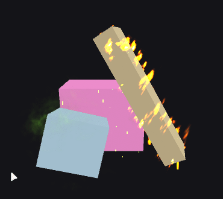
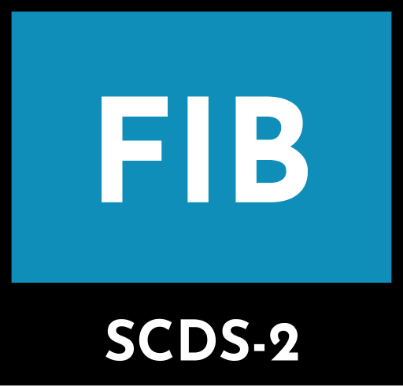

# RichViewport


A special viewport class wrapper that supports emulated `ParticleEmitter` instances in 3D space.

> [!WARNING]
> THIS DOES NOT WORK IN LIVE GAMES YET! This relies on the `ParticleEmitter2D` instance in Studio, which is still in beta. **Studio UI Particles beta** must be enabled (File → Beta Features) for this to work!

## Installation
You can get this package from the releases folder. Alternatively, you can install from Pesde: 

```sh
pesde add miagobble/rich_viewport
```

## Quick start
Constructing a RichViewport is as simple as giving it a source object, camera, and frame to parent to:

```lua
local View = RichViewport.new(SourceModel, Camera, ParentFrame)
```

`Object` is **cloned** into the viewport. The live clone is exposed as `View.Object`.

## API

### Constructor
`RichViewport.new(Object, Camera, Parent) -> RichViewport`

| Arg | Type | Notes |
| --- | --- | --- |
| `Object` | `Instance` | Source to clone into the viewport |
| `Camera` | `Camera` | Drives the `ViewportFrame` |
| `Parent` | `GuiObject` | Parent for the overlay root |

### Properties

- `Object` — live viewport clone (rebind with `SetObject`)
- `Camera` — rebind with `SetCamera`
- `Parent` — rebind with `SetParent`
- `ViewportFrame`
- `Scope` — Seam scope (destroyed with the view)
- `Destroyed` / `Refreshed` — signals

Submodules (also available as `RichViewport.Spatial`, `.Overlays`, `.Particles`):

- **Spatial** — projection, AABB/OBB bounds, focus CFrame
- **Overlays** — Behind / Viewport / Front stack
- **Particles** — `ParticleEmitter` → `ParticleEmitter2D` mimics

### Methods
| Method | Description |
| --- | --- |
| `SetObject(Object)` | Clone a new source into the viewport and rebuild |
| `SetCamera(Camera)` | Rebind the camera driving the ViewportFrame(s) |
| `SetParent(Parent)` | Reparent the overlay root |
| `Refresh()` | Force bounds + particle mimic update; fires `Refreshed` |
| `ShowDebug()` / `HideDebug()` | Oriented bound guides (hidden by default) |
| `ShowParticles()` / `HideParticles()` | Particle mimics (shown by default) |
| `EnableBasePartLayering()` / `DisableBasePartLayering()` | Refcounted: per-part viewports interleaved with particle hosts for mesh occlusion (off by default) |
| `IsBasePartLayeringEnabled()` | Whether layering refcount is above zero |
| `Destroy()` | Tears down scope, overlays, watchers; fires `Destroyed` |

## Local demo

This repo includes a UI Labs story and place template:

```sh
pesde install
lune run build
```

Open `build.rbxl`, enable UI Particles beta, and run the story under `ReplicatedFirst.Modules`.

## How this works
I want to make clear that, yes, you aren't crazy: Roblox still does not support many different instances in viewports, including 3D particles!

A high-level overview is that this is using `ParticleEmitter2D` and a bunch of math to *emulate* how particles would look in a viewport frame. This is quite an effective method since 2D particles have a lot of property parity with 3D particles!

However, that's not all of it. To get this working, we need to create invisible UI elements that 2D particles can be parented to. To do this, I made oriented bounding boxes (as opposed to AABB) since they closely fit on each object.

Once those bounding boxes are created, we create `ParticleEmitter2D` instances, one for each 3D emitter, to emulate the particles. Out of the box this already starts to look similar to what we're doing, but there are some other problems that need to be solved, such as:
* Layering
* Perspective-related issues
* Particles in 3D area

Layering and particles in 3D area are solved in a similar way. Obviously you can't put 2D things in a 3D part, so the next best solution is to create two emitters per 3D emitter: one for in front of the part, and one behind. This gives the illusion of particles spawning inside of the part. After that we just need to optionally layer viewports for separate parent instance to give the illusion of closer objects emitting on top of farther ones.

Perspective is the biggest problem and limitation of this all. 3D particle emitters can emit from different surfaces, have perspective modes (such as emitting in parallel), have squash and rotation, etc. Perspective is a pinhole-camera projection from the viewport's camera, using a second layer that turns 3D motion into 2d emitter angle, speed, and squash; these properties are essential at creating this illusion.

I do not know the exact math of this since I had AI work out those details, and so as such I will have AI show the details:

### World → screen pixels
Studio's `Camera:WorldToViewportPoint` is avoided because ViewportFrame cameras keep `ViewportSize` at `(1, 1)` and break aspect. Projection is done manually with vertical FOV and the overlay's pixel size.

In camera space, Roblox looks down **−Z**, so depth is:

$$
\text{Depth} = -R_z
$$

Half of the vertical view height in studs at that depth:

$$
H = \tan(\mathrm{FOV}/2) \cdot \text{Depth},\quad
W = H \cdot \frac{\text{PixelWidth}}{\text{PixelHeight}}
$$

Then:

$$
x = \Bigl(\tfrac{R_x}{W}\cdot\tfrac12 + \tfrac12\Bigr) W_{\text{px}},\quad
y = \Bigl(-\tfrac{R_y}{H}\cdot\tfrac12 + \tfrac12\Bigr) H_{\text{px}}
$$

(`Y` is flipped so +up in world → up on screen.) That is `Spatial.WorldToViewportPixels`.

**Pixels-per-stud** at a depth (the scale used for Size / Speed) is vertical only:

$$
\mathrm{PPS} = \frac{H_{\text{px}}}{2H} = \frac{H_{\text{px}}}{2\tan(\mathrm{FOV}/2)\cdot\text{Depth}}
$$

Farther → smaller PPS → smaller / slower 2D particles.

### Directions → emission angle + foreshortening
A world direction is taken into camera space. The **screen residual** is $(R_x, -R_y)$:

- **Angle** = $\text{atan2}(R_y^{\text{screen}}, R_x)$ (0 = screen right)
- **ScreenFraction** = $\lVert(R_x,-R_y)\rVert / \lVert R\rVert$  
  → 1 = fully lateral, 0 = pure depth (into / out of the camera)

`ParticleEmitter2D` uses **0 = parent local up**, so screen atan2 is shifted **+90°**, then **minus the emit host's `GuiObject.Rotation`** so AbsoluteRotation does not double-yaw particles.

If the emit axis is nearly view-aligned (ScreenFraction below ~0.22), the XY residual is noisy, so a ⊥ basis $(U, V)$ is built around that axis and the stronger screen axis is picked (with a small horizontal bias). That keeps face-on discs from flipping 180°.

### Speed “perspective”
```text
Speed₂D = Speed₃D × PPS × SpeedFraction
```

- **FacingCamera\***: `SpeedFraction = 1` (full PPS)
- **Velocity\***: `SpeedFraction = max(ScreenFraction, 0.35)`  
  Depth-heavy travel barely moves on screen, so speed is scaled down; the 0.35 floor stops emitters from dying when face-on.

Size always uses full PPS (apparent scale by depth only).

### Palm foreshortening (Velocity\* only)
Treat the emission direction as the particle's “palm” normal:

$$
\text{Facing} = \lvert \hat n \cdot (-\text{LookVector}) \rvert
$$

Then $\text{EdgeOn} = (1 - \text{Facing})^2$, $\text{SpinScale} = \text{Facing}^2$:

- Face-on → billboard-ish, full spin, little extra squash
- Edge-on → blend toward a soft squash (~0.35), damp `RotSpeed`, and bias sprite rotation along / across travel (`VelocityParallel`: Rotation ≈ EmissionAngle; `VelocityPerpendicular`: EmissionAngle + 90)

**FacingCamera** skips this entirely — authored Rotation / Squash / RotSpeed only (parent-local).

### Acceleration
World acceleration → camera XY (Y flipped) × PPS, then **rotated by −ParentRotation** into the emit frame's local axes so gravity stays screen-correct under a rotated OBB host.

### Mental model
Depth sets a uniform stud→pixel scale; the emit axis's lateral vs depth split sets how much 2D travel you see; Velocity\* modes additionally fake the disc tipping toward / away from the camera with squash and spin.

## Limitations
Obviously, this library is early in development and comes with so many caveats... this should go without saying.

I won't go into the details of all of it, but it really just boils down to how much you can really push 2D space to mimic 3D space. Often times with particles you'll run into really weird perspective issues. While I will do my best to update this library and work out kinks over time, it'll never be perfect. Roblox just needs to add official support for this.

## What's next?
Other than improving what is already here, I would like to add support for other instances that don't work, such as beams and trails. Every instance type requires a different problem to solve, so this is tricky! Feel free to make a PR at any time to propose adding any of these.

## SCDS Rating


*I designed this solution myself, both on a high-level and technical-level. However, AI was used to speed up the process by implementing the specifics, including the boilerplate and math.*